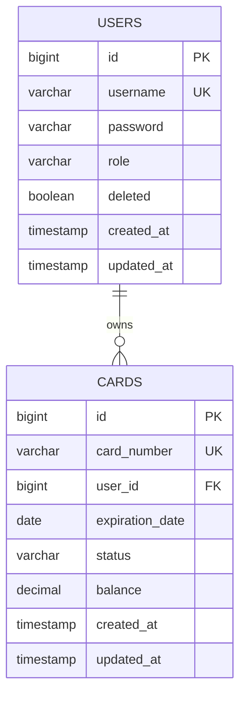

# Схема данных

Схема ниже соответствует миграции `v1_init_schema.sql`. Сущности `users` и `cards` связаны как один ко многим. Отдельной таблицы переводов нет: операция меняет `balance` двух строк `cards`.

| Поле | Смысл / ограничение |
| --- | --- |
| `users.username` | Уникальный логин |
| `users.password` | Хэш пароля BCrypt |
| `users.role` | `ADMIN` или `USER` |
| `users.deleted` | Признак мягкого удаления |
| `cards.card_number` | Уникальный 16-значный номер; **в БД открытый текст** |
| `cards.user_id` | Обязательная ссылка на владельца |
| `cards.status` | `ACTIVE`, `BLOCKED`, `EXPIRED` |
| `cards.balance` | `DECIMAL(15,2)`, по умолчанию 0 |

Маска `**** **** **** 1234` формируется `CardMapper` при выдаче DTO; она не меняет значение в `cards.card_number`.
